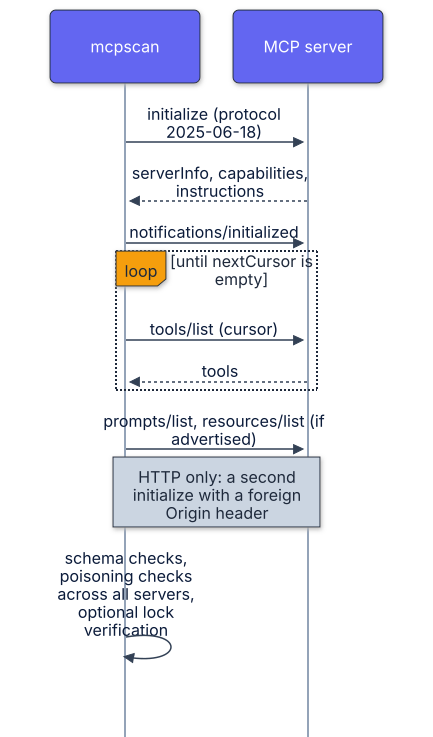

# Architecture

`mcpscan` is one Go binary with four ways in (CLI, GitHub Action, HTTP service, benchmark
generator) and four analyzers that share a finding model and the rule catalog in
`internal/findings`.

## Packages

| Package | Role |
|---|---|
| `internal/lexer` | Tokenizer for JavaScript, TypeScript and Python: decoded strings, flattened template literals and f-strings, regex literals, Python logical lines and indentation. |
| `internal/analysis` | File discovery, function and handler discovery, import aliases, the taint engine, secret and configuration rules, and extraction of tool definitions from source. |
| `internal/poison` | Checks on the text a model reads: descriptions, titles, parameter descriptions, prompts, resources and server instructions; cross-server name collisions and shadowing. |
| `internal/manifest` | The manifest model (tools, prompts, resources), schema and annotation checks, canonical JSON, and the pin and verify logic behind `mcp-lock.json`. |
| `internal/mcp` | A minimal MCP client: stdio and Streamable HTTP (JSON and SSE responses, sessions, pagination, server to client requests), client configuration loading, and transport checks. |
| `internal/report` | Text, JSON and SARIF 2.1.0 writers. |
| `internal/server` | HTTP service: `/v1/scan/source`, `/v1/scan/manifest`, `/health`, `/ready`, `/metrics`. |
| `internal/plant` | Planted-vulnerability and tool-poisoning benchmark generators and scoring. |
| `internal/demoserver` | Inert demo MCP server (clean, poisoned, rug pull) for tests and demos. |
| `internal/cli` | Command line. |

## Static scan

  

Legend: amber = entry points and external systems, indigo = core logic, green = data and state, blue = validation and control, grey = observability and outputs.

1. **Collect.** Walk the tree, skipping `node_modules`, build output, hidden directories, test
   files and directories (unless `--include-tests`), files over 1 MB and minified bundles.
2. **Parse.** Each file is lexed and indexed in a worker pool: matching brackets, the innermost
   enclosing bracket of every token, import aliases (`import { exec as run } from
   "child_process"`, `const cp = require(...)`, `promisify(exec)`, `from os import system`) and
   functions (declarations, arrows, methods, Python `def` with decorators).
3. **Sources.** Handlers are found as described in [ADR 0004](adr/0004-where-tool-input-comes-from.md).
   Schema declarations (`z.number()`, `type: "number"`, `Literal[...]`, `int`) mark parameters
   that cannot carry an injection string.
4. **Taint.** For each handler, one ordered pass over the body updates a map from variable
   chains (`args.path`) to three taint bits (command, path, URL host). Calls are resolved to a
   sink, a sanitizer, a repository function (through summaries computed on demand, depth four)
   or an unknown function (propagate). See [ADR 0003](adr/0003-token-level-taint-with-summaries.md).
5. **Rules on tokens.** Secrets use provider formats with placeholder and entropy filters, plus a
   generic rule for random-looking literals assigned to secret-named variables. Configuration
   rules look for broad OAuth scopes in scope assignments, bind-all listeners, wildcard CORS and
   disabled certificate checks.

## Live probe

  

Server to client requests are answered (`ping`) or declined (sampling, roots, elicitation),
non-JSON lines on stdout are skipped, and writes to a stuck server time out instead of blocking.

## Rug-pull pinning

`pin` hashes each tool field in canonical JSON and stores the hashes in `mcp-lock.json`;
`verify` compares and names the fields that changed. See
[ADR 0005](adr/0005-pinning-tool-definitions.md).

## Memory and concurrency

Parsing runs in `GOMAXPROCS` workers; taint analysis of one repository runs on one goroutine
because summaries are memoized in a map. The binary sets a 1 GiB soft memory limit unless
`GOMEMLIMIT` is set. Token texts are slices of one string per file rather than separate
allocations, and token slices are trimmed to size, because every file's tokens stay in memory
for the cross-file pass. The largest corpus repository (61 MB of scanned source, 6.8 million
tokens) peaks at about 755 MB resident; the median repository at about 20 MB.
